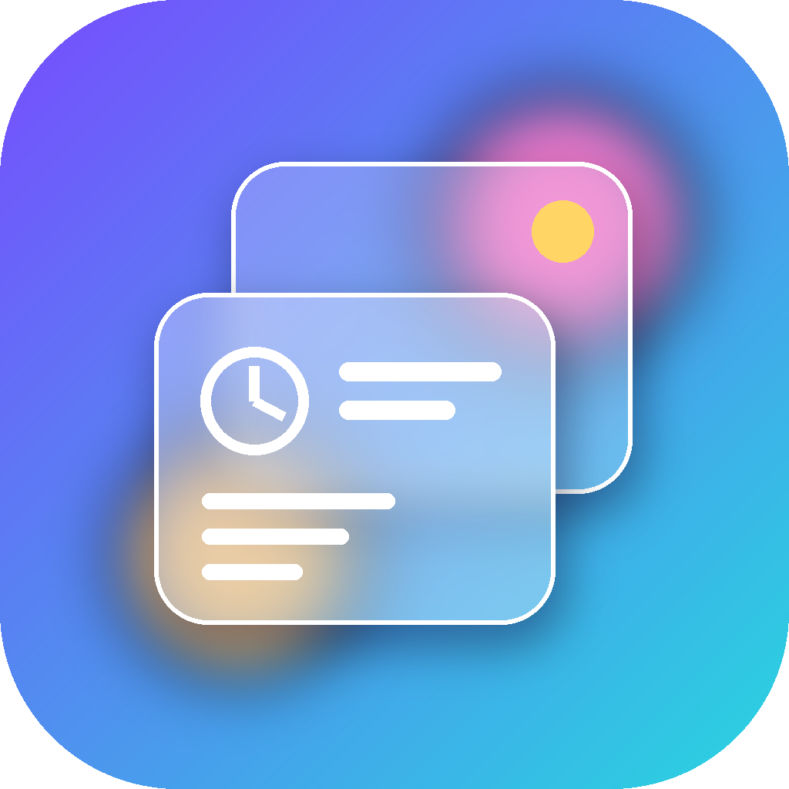
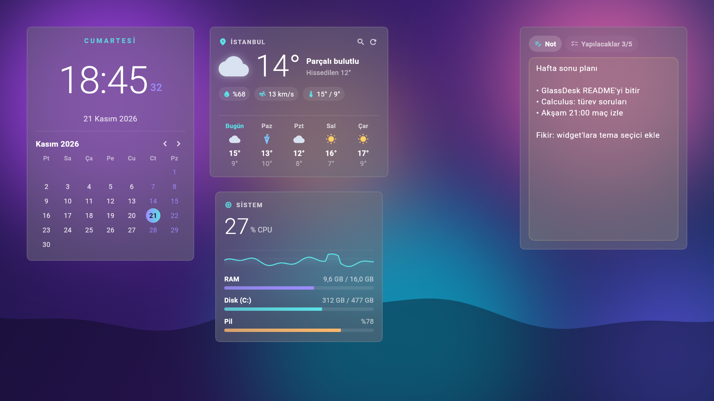
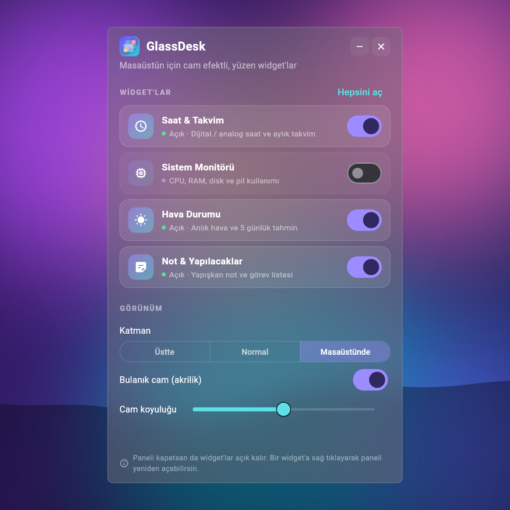
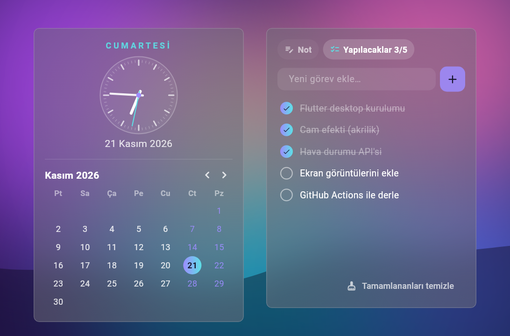

<p align="center">
  
</p>

<h1 align="center">GlassDesk</h1>

<p align="center">
  Masaüstünde yüzen, cam efektli widget'lar: saat & takvim, sistem monitörü, hava durumu, not & yapılacaklar.
  <br>
  <b>Flutter Desktop</b> ile yazıldı · Windows & Linux
</p>

<p align="center">
  <a href="https://github.com/muba14/GlassDesk/actions/workflows/ci.yml"></a>
  
  
  
</p>

---

## Ekran görüntüleri



| Kontrol paneli | Analog saat & yapılacaklar |
| :---: | :---: |
|  |  |

> Ekran görüntüleri uygulamanın kendi widget'larından, örnek bir duvar kağıdı üzerinde otomatik üretilir (bkz. [Ekran görüntülerini yeniden üretmek](#ekran-görüntülerini-yeniden-üretmek)).

## Özellikler

| Widget | Ne yapar |
| --- | --- |
| 🕒 **Saat & Takvim** | Büyük dijital saat ve tarih, aylar arasında gezilebilen takvim. Saate tıklayınca **analog** moda geçer. |
| 📊 **Sistem Monitörü** | Canlı CPU grafiği; RAM, disk ve pil kullanımı. Windows'ta doğrudan `kernel32` (FFI), Linux'ta `/proc` üzerinden okunur. |
| ⛅ **Hava Durumu** | Anlık sıcaklık, hissedilen, nem, rüzgar ve 5 günlük tahmin. Şehir aranarak değiştirilebilir. [Open-Meteo](https://open-meteo.com) kullanır, API anahtarı gerekmez. |
| 📝 **Not & Yapılacaklar** | Otomatik kaydedilen yapışkan not ve tamamlananları temizlenebilen görev listesi. |

**Ortak özellikler**

- 🪟 **Ayrı ayrı yüzen pencereler:** Her widget kendi çerçevesiz penceresinde açılır. İstediğin yere sürükle, konumu hatırlanır.
- 🧊 **Cam efekti:** Windows'ta gerçek akrilik bulanıklık. Camın koyuluğu panelden ayarlanır.
- 📌 **Katman seçimi:** Widget'lar *Üstte*, *Normal* ya da *Masaüstünde* (diğer pencerelerin altında) durabilir.
- 🖱️ **Sağ tık menüsü:** Paneli aç, konumu sıfırla ya da widget'ı kapat. Üzerine gelince köşede kapatma düğmesi çıkar.
- 💾 **Kalıcı ayarlar:** Açık widget'lar, konumlar, şehir, notlar ve görevler bir sonraki açılışta geri gelir.

## Kurulum

### Hazır sürüm

[Releases](https://github.com/muba14/GlassDesk/releases) sayfasından (ya da son başarılı [Actions](https://github.com/muba14/GlassDesk/actions) çalışmasının *Artifacts* bölümünden) işletim sistemine uygun paketi indir:

- **Windows:** `GlassDesk-windows-x64.zip` dosyasını bir klasöre çıkar ve `glassdesk.exe`'yi çalıştır.
- **Linux:** `GlassDesk-linux-x64.tar.gz` dosyasını çıkar ve `./glassdesk` komutunu çalıştır.

### Kaynaktan derleme

Gereksinimler: [Flutter](https://docs.flutter.dev/get-started/install) (stable), Windows için Visual Studio'nun *Desktop development with C++* bileşeni, Linux için `clang cmake ninja-build pkg-config libgtk-3-dev`.

```bash
git clone https://github.com/muba14/GlassDesk.git
cd GlassDesk
flutter pub get
flutter run -d windows   # ya da: flutter run -d linux
```

## Kullanım

1. Uygulamayı açınca **kontrol paneli** gelir. İlk açılışta dört widget da otomatik açılır.
2. Paneldeki anahtarlarla widget'ları aç/kapat. **Görünüm** bölümünden katmanı, bulanıklığı ve cam koyuluğunu ayarla.
3. Widget'ları sürükleyerek yerleştir (not widget'ı üstteki sekme satırından sürüklenir).
4. Paneli kapatsan da widget'lar açık kalır. Paneli geri açmak için bir widget'a **sağ tıkla → GlassDesk panelini aç**.

## Nasıl çalışır?

GlassDesk tek bir program ama iki modda çalışır:

```
glassdesk                  → kontrol paneli
glassdesk --widget=clock   → yalnızca saat widget'ı (clock | system | weather | notes)
```

Panel her widget'ı ayrı bir **süreç** olarak başlatır. Böylece her widget kendi şeffaf, çerçevesiz penceresine sahip olur. Süreçler birbirleriyle uygulama veri klasöründeki küçük JSON dosyaları üzerinden haberleşir:

- `config.json`: hangi widget'ların açık olduğu ve görünüm ayarları (panel yazar, widget'lar birkaç saniyede bir okur)
- `hb_<widget>`: widget'ın açık olduğunu gösteren "kalp atışı"
- `widget_<widget>.json`, `notes.json`: konum, şehir, saat modu, notlar ve görevler

### Proje yapısı

```
lib/
├── main.dart                  # Başlatıcı mı widget mı? Argümana göre seçer
└── src/
    ├── launcher/              # Kontrol paneli (mantık + görünüm)
    ├── widgets/
    │   ├── clock/             # Saat, analog saat, Türkçe takvim
    │   ├── system/            # CPU/RAM/disk/pil (Windows FFI, Linux /proc)
    │   ├── weather/           # Open-Meteo istemcisi + arayüz
    │   └── notes/             # Not ve yapılacaklar
    ├── widget_window.dart     # Yüzen pencere kabuğu (sürükleme, menü, konum)
    ├── desktop.dart           # window_manager + flutter_acrylic yardımcıları
    ├── config.dart            # Paylaşılan ayarlar ve kalp atışı
    ├── glass_panel.dart       # Cam yüzey bileşenleri
    └── theme.dart
test/                          # Birim, widget ve ekran görüntüsü testleri
tool/make_icon.py              # Logoyu üretir
```

### Kullanılan paketler

- [`window_manager`](https://pub.dev/packages/window_manager): çerçevesiz pencere, konum, katman
- [`flutter_acrylic`](https://pub.dev/packages/flutter_acrylic): Windows akrilik efekti
- [`path_provider`](https://pub.dev/packages/path_provider): uygulama veri klasörü
- [`ffi`](https://pub.dev/packages/ffi): Windows sistem bilgisi için yerel çağrılar

## Geliştirme

```bash
flutter analyze
flutter test
```

### Ekran görüntülerini yeniden üretmek

```bash
flutter test test/screenshot_test.dart --dart-define=SCREENSHOTS=true
```

Görseller `docs/screenshots/` klasörüne yazılır.

## Lisans

[MIT](LICENSE) © muba14
